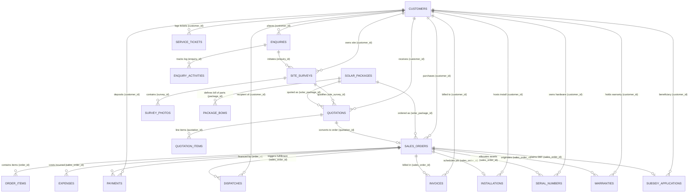
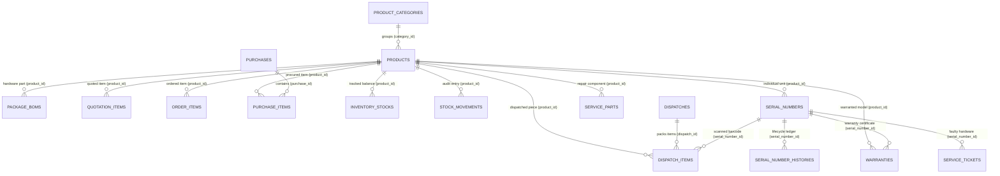
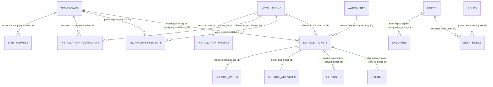

# Odoo Solar ERP — Complete Database Schema & Relational Mapping

This document provides the definitive architectural blueprint of the **Enterprise Solar ERP Database Schema** (MySQL 8.0+ / Spring Boot JPA / Hibernate 6). It details all **36 normalized tables**, their primary keys (`PK`), foreign keys (`FK`), relational multiplicities (`1:N`, `N:1`, `1:1`), cascading rules, and visual connector diagrams tracing how master records cascade across downstream business operations.

---

## 1. Visual Entity Relationship (ER) Diagrams with Connectors

### 1.1 Core Business Pipeline & Customer Lifecycle



---

### 1.2 Logistics, Hardware Inventory & Serial Number Tracking



---

### 1.3 Field Engineering, Crew & Customer Service Ticket Pipeline



---

## 2. Visual ASCII Schema Connector Tables

The diagrams below visually trace how a **Single Primary Key (`PK`)** in an authoritative master table connects as a **Foreign Key (`FK`)** into multiple dependent operational tables across the system.

### 2.1 The Master Customer Hub (`customers.id` PK)

```
   ┌─────────────────────────────────────────────────────────────┐
   │                   TABLE: customers                          │
   │  PK: id BIGINT AUTO_INCREMENT                               │
   └───────────────┬─────────────────────────────────────────────┘
                   │
                   ├──> [enquiries]                . customer_id (FK)
                   ├──> [site_surveys]             . customer_id (FK)
                   ├──> [quotations]               . customer_id (FK)
                   ├──> [sales_orders]             . customer_id (FK)
                   ├──> [dispatches]               . customer_id (FK)
                   ├──> [installations]            . customer_id (FK)
                   ├──> [payments]                 . customer_id (FK)
                   ├──> [invoices]                 . customer_id (FK)
                   ├──> [serial_numbers]           . customer_id (FK)
                   ├──> [warranties]               . customer_id (FK)
                   ├──> [service_tickets]          . customer_id (FK)
                   └──> [subsidy_applications]     . customer_id (FK)
```

---

### 2.2 The Solar Sales Order Hub (`sales_orders.id` PK)

```
   ┌─────────────────────────────────────────────────────────────┐
   │                   TABLE: sales_orders                       │
   │  PK: id BIGINT AUTO_INCREMENT                               │
   └───────────────┬─────────────────────────────────────────────┘
                   │
                   ├──> [order_items]              . order_id (FK)
                   ├──> [payments]                 . order_id (FK)
                   ├──> [invoices]                 . sales_order_id (FK)
                   ├──> [expenses]                 . sales_order_id (FK)
                   ├──> [dispatches]               . sales_order_id (FK)
                   ├──> [installations]            . sales_order_id (FK)
                   ├──> [serial_numbers]           . sales_order_id (FK)
                   ├──> [warranties]               . sales_order_id (FK)
                   └──> [subsidy_applications]     . sales_order_id (FK)
```

---

### 2.3 The Master Hardware Catalog Hub (`products.id` PK)

```
   ┌─────────────────────────────────────────────────────────────┐
   │                   TABLE: products                           │
   │  PK: id BIGINT AUTO_INCREMENT                               │
   └───────────────┬─────────────────────────────────────────────┘
                   │
                   ├──> [package_boms]             . product_id (FK)
                   ├──> [quotation_items]          . product_id (FK)
                   ├──> [order_items]              . product_id (FK)
                   ├──> [purchase_items]           . product_id (FK)
                   ├──> [inventory_stocks]         . product_id (FK)
                   ├──> [stock_movements]          . product_id (FK)
                   ├──> [serial_numbers]           . product_id (FK)
                   ├──> [dispatch_items]           . product_id (FK)
                   ├──> [warranties]               . product_id (FK)
                   └──> [service_parts]            . product_id (FK)
```

---

### 2.4 Serialized Hardware Tracking Hub (`serial_numbers.id` PK)

```
   ┌─────────────────────────────────────────────────────────────┐
   │                   TABLE: serial_numbers                     │
   │  PK: id BIGINT AUTO_INCREMENT                               │
   └───────────────┬─────────────────────────────────────────────┘
                   │
                   ├──> [dispatch_items]           . serial_number_id (FK)
                   ├──> [serial_number_histories]  . serial_number_id (FK)
                   ├──> [warranties]               . serial_number_id (FK)
                   └──> [service_tickets]          . serial_number_id (FK)
```

---

### 2.5 Field Engineering & Crew Hub (`technicians.id` PK)

```
   ┌─────────────────────────────────────────────────────────────┐
   │                   TABLE: technicians                        │
   │  PK: id BIGINT AUTO_INCREMENT                               │
   └───────────────┬─────────────────────────────────────────────┘
                   │
                   ├──> [site_surveys]             . technician_id (FK)
                   ├──> [installation_technicians] . technician_id (FK)
                   ├──> [technician_payments]      . technician_id (FK)
                   └──> [service_tickets]          . assigned_technician_id (FK)
```

---

### 2.6 Field Project Execution Hub (`installations.id` PK)

```
   ┌─────────────────────────────────────────────────────────────┐
   │                   TABLE: installations                      │
   │  PK: id BIGINT AUTO_INCREMENT                               │
   └───────────────┬─────────────────────────────────────────────┘
                   │
                   ├──> [installation_photos]      . installation_id (FK)
                   ├──> [installation_technicians] . installation_id (FK)
                   ├──> [technician_payments]      . installation_id (FK)
                   └──> [service_tickets]          . installation_id (FK)
```

---

### 2.7 Post-Sales Warranty & Breakdown Hub (`service_tickets.id` & `warranties.id` PK)

```
   ┌─────────────────────────────────────────────────────────────┐
   │                   TABLE: warranties                         │
   │  PK: id BIGINT AUTO_INCREMENT                               │
   └───────────────┬─────────────────────────────────────────────┘
                   │
                   └──> [service_tickets]          . warranty_id (FK)
                               │
   ┌───────────────────────────┴─────────────────────────────────┐
   │                   TABLE: service_tickets                    │
   │  PK: id BIGINT AUTO_INCREMENT                               │
   └───────────────┬─────────────────────────────────────────────┘
                   │
                   ├──> [service_parts]            . ticket_id (FK)
                   ├──> [service_activities]       . ticket_id (FK)
                   ├──> [expenses]                 . service_ticket_id (FK)
                   └──> [invoices]                 . service_ticket_id (FK)
```

---

## 3. Comprehensive Data Dictionary & Schema Tables

### Module 1: CRM, Lead Management & Site Feasibility

#### Table 1.1: `customers`
*Stores residential and commercial solar client master profiles.*
| Column | Type | Constraints | Description |
|---|---|---|---|
| **`id`** | BIGINT | **PK**, AUTO_INCREMENT | Unique internal Customer identifier. |
| `full_name` | VARCHAR(120) | NOT NULL | Customer full name or business entity. |
| `phone` | VARCHAR(20) | NOT NULL, INDEX | Primary mobile number for WhatsApp & survey calls. |
| `email` | VARCHAR(120) | NULL | Customer email for quotes, invoices, and warranties. |
| `address` | TEXT | NOT NULL | Complete premises installation address. |
| `city` | VARCHAR(60) | NOT NULL, DEFAULT 'Chennai' | City / Municipality. |
| `pincode` | VARCHAR(10) | NULL | Postal Code. |
| `created_at` | DATETIME | NOT NULL | Record creation timestamp. |
| `updated_at` | DATETIME | NULL | Last modification timestamp. |

#### Table 1.2: `enquiries`
*Captures inbound inquiries from web forms, walk-ins, and phone leads.*
| Column | Type | Constraints | Description |
|---|---|---|---|
| **`id`** | BIGINT | **PK**, AUTO_INCREMENT | Primary Key. |
| `enquiry_number` | VARCHAR(50) | NOT NULL, UNIQUE | Human-readable identifier (e.g. `ENQ-2026-0001`). |
| `customer_id` | BIGINT | **FK** -> `customers.id` | The prospective solar customer. |
| `requested_capacity_kw` | DECIMAL(5,2) | NOT NULL | Desired capacity (1.00 kW to 5.00 kW). |
| `monthly_electricity_bill` | DECIMAL(10,2) | NULL | Current DISCOM monthly bill (₹). |
| `shadow_free_area_sq_ft` | DECIMAL(10,2) | NULL | Estimated rooftop area available. |
| `assigned_to_user_id` | BIGINT | **FK** -> `users.id` | Sales Consultant handling the lead. |
| `status` | VARCHAR(30) | NOT NULL | `NEW`, `CONTACTED`, `SURVEY_REQUESTED`, `CONVERTED`, `LOST`. |
| `notes` | TEXT | NULL | Sales qualification notes. |
| `created_at` | DATETIME | NOT NULL | Timestamp of inquiry submission. |
| `updated_at` | DATETIME | NULL | Timestamp of status update. |

#### Table 1.3: `enquiry_activities`
*Maintains a complete CRM interaction log per lead.*
| Column | Type | Constraints | Description |
|---|---|---|---|
| **`id`** | BIGINT | **PK**, AUTO_INCREMENT | Primary Key. |
| `enquiry_id` | BIGINT | **FK** -> `enquiries.id` (CASCADE) | Associated enquiry. |
| `action` | VARCHAR(60) | NOT NULL | `CALL_LOGGED`, `WHATSAPP_SENT`, `SITE_REQUESTED`. |
| `notes` | TEXT | NULL | Agent notes detailing the conversation. |
| `performed_by` | VARCHAR(100) | NOT NULL | User/Agent identity. |
| `created_at` | DATETIME | NOT NULL | Log timestamp. |

#### Table 1.4: `site_surveys`
*Physical engineering inspection report conducted on the customer rooftop.*
| Column | Type | Constraints | Description |
|---|---|---|---|
| **`id`** | BIGINT | **PK**, AUTO_INCREMENT | Primary Key. |
| `survey_number` | VARCHAR(50) | NOT NULL, UNIQUE | Unique survey code (e.g. `SURV-2026-0042`). |
| `customer_id` | BIGINT | **FK** -> `customers.id` | Customer whose premises was surveyed. |
| `enquiry_id` | BIGINT | **FK** -> `enquiries.id` | Source lead. |
| `technician_id` | BIGINT | **FK** -> `technicians.id` | Certified field engineer conducting the survey. |
| `scheduled_date` | DATE | NOT NULL | Planned visit date. |
| `roof_direction` | VARCHAR(30) | NOT NULL | `South`, `South-West`, `East`, `Flat`. |
| `roof_tilt` | VARCHAR(30) | NOT NULL | Angle of tilt (e.g. `13 Degrees`). |
| `available_roof_area_sq_ft` | DECIMAL(10,2) | NOT NULL | Measured physical shadow-free area. |
| `cable_distance_meters` | DECIMAL(6,2) | NOT NULL | DC run distance from array to inverter point. |
| `shading_assessment` | VARCHAR(50) | NOT NULL | `Zero Shade`, `Partial East Shade`, `High Parapet`. |
| `grid_suitability` | VARCHAR(50) | NOT NULL | `Suitable (1-Phase)`, `Suitable (3-Phase)`, `Overloaded Transformer`. |
| `roof_condition` | VARCHAR(100) | NULL | RCC Concrete, Metal Profile Sheet, Mangalore Tile. |
| `structural_observations` | TEXT | NULL | Anchor point pull-out strength & wind rating. |
| `inspection_recommendation` | TEXT | NULL | Recommended kW rating and mounting stance. |
| `status` | VARCHAR(30) | NOT NULL | `SCHEDULED`, `COMPLETED`, `APPROVED`, `REJECTED`. |
| `approved_by` | VARCHAR(100) | NULL | Lead Engineer sign-off name. |
| `approval_date` | DATETIME | NULL | Timestamp of approval (Unlocks Quotation creation). |
| `approval_notes` | TEXT | NULL | Executive review comments. |
| `created_at` | DATETIME | NOT NULL | Survey scheduling timestamp. |
| `updated_at` | DATETIME | NULL | Inspection submission timestamp. |

#### Table 1.5: `survey_photos`
*High-resolution geo-tagged photographs captured on the roof.*
| Column | Type | Constraints | Description |
|---|---|---|---|
| **`id`** | BIGINT | **PK**, AUTO_INCREMENT | Primary Key. |
| `survey_id` | BIGINT | **FK** -> `site_surveys.id` (CASCADE) | Associated site survey. |
| `photo_url` | TEXT | NOT NULL | File path or CDN URL of the roof image. |
| `caption` | VARCHAR(150) | NULL | Description (e.g. *South-East Obstruction Check*). |
| `uploaded_at` | DATETIME | NOT NULL | Upload timestamp. |

---

### Module 2: Catalog, Products & Bill of Materials (BOM)

#### Table 2.1: `product_categories`
*Hardware classifications for ERP inventory.*
| Column | Type | Constraints | Description |
|---|---|---|---|
| **`id`** | BIGINT | **PK**, AUTO_INCREMENT | Primary Key. |
| `name` | VARCHAR(60) | NOT NULL, UNIQUE | `Solar Panel`, `Inverter`, `Battery`, `Stands`, `Switchgear`. |
| `description` | TEXT | NULL | Scope of category. |

#### Table 2.2: `products`
*Master inventory item catalog with pricing and warranty attributes.*
| Column | Type | Constraints | Description |
|---|---|---|---|
| **`id`** | BIGINT | **PK**, AUTO_INCREMENT | Primary Key. |
| `product_code` | VARCHAR(50) | NOT NULL, UNIQUE | SKU identifier (e.g. `PNL-MONO-550W`). |
| `name` | VARCHAR(150) | NOT NULL | Commercial product title. |
| `category_id` | BIGINT | **FK** -> `product_categories.id` | Item category. |
| `description` | TEXT | NULL | Detailed specifications (Wattage, Voltage, Dimensions). |
| `requires_serial` | BOOLEAN | NOT NULL, DEFAULT 0 | 1 = Barcode serial tracking required; 0 = Bulk hardware. |
| `warranty_years` | INT | NOT NULL, DEFAULT 0 | Standard warranty period (e.g. 20 for PV, 2 for Inverter). |
| `unit_cost` | DECIMAL(10,2) | NOT NULL | Live purchase / landed cost from supplier. |
| `selling_price` | DECIMAL(10,2) | NOT NULL | Base catalog selling price before discounts. |
| `reorder_level` | INT | NOT NULL, DEFAULT 10 | Minimum safety stock threshold. |
| `created_at` | DATETIME | NOT NULL | Catalog creation timestamp. |
| `updated_at` | DATETIME | NULL | Price update timestamp. |

#### Table 2.3: `solar_packages`
*Standardized 1kW to 5kW turnkey consumer packages.*
| Column | Type | Constraints | Description |
|---|---|---|---|
| **`id`** | BIGINT | **PK**, AUTO_INCREMENT | Primary Key. |
| `name` | VARCHAR(100) | NOT NULL | `3 kW On-Grid Subsidy Bestseller Package`. |
| `system_type` | VARCHAR(30) | NOT NULL | `ON_GRID`, `OFF_GRID`, `HYBRID`. |
| `capacity_kw` | DECIMAL(5,2) | NOT NULL | Sizing capacity (1.00 to 5.00 kW). |
| `base_price` | DECIMAL(12,2) | NOT NULL | Standard retail turnkey quote. |
| `installation_fee` | DECIMAL(10,2) | NOT NULL | Standard labor and civil works portion. |
| `subsidy_eligible_amount` | DECIMAL(10,2) | NOT NULL, DEFAULT 0.00 | Central Govt PM Surya Ghar subsidy value (₹). |
| `description` | TEXT | NULL | Consumer-facing package highlights. |
| `created_at` | DATETIME | NOT NULL | Package initialization timestamp. |
| `updated_at` | DATETIME | NULL | Last modification timestamp. |

#### Table 2.4: `package_boms`
*Automated Bill of Materials defining hardware components required for each turnkey package.*
| Column | Type | Constraints | Description |
|---|---|---|---|
| **`id`** | BIGINT | **PK**, AUTO_INCREMENT | Primary Key. |
| `package_id` | BIGINT | **FK** -> `solar_packages.id` (CASCADE) | Parent package template. |
| `product_id` | BIGINT | **FK** -> `products.id` | Hardware inventory component. |
| `quantity` | INT | NOT NULL CHECK (quantity > 0) | Quantity needed per installation (e.g. 6 panels). |
| `role_in_package` | VARCHAR(100) | NULL | Function (`Main Generation`, `Grid Inversion`, `Protection`). |

---

### Module 3: Sales, Quotations & Customer Orders

#### Table 3.1: `quotations`
*Sales price proposals dynamically generated with live BOM inventory costing.*
| Column | Type | Constraints | Description |
|---|---|---|---|
| **`id`** | BIGINT | **PK**, AUTO_INCREMENT | Primary Key. |
| `quotation_number` | VARCHAR(50) | NOT NULL, UNIQUE | Quote identifier (e.g. `QT-2026-0128`). |
| `customer_id` | BIGINT | **FK** -> `customers.id` | Customer receiving the quote. |
| `site_survey_id` | BIGINT | **FK** -> `site_surveys.id` | Required approved survey. |
| `solar_package_id` | BIGINT | **FK** -> `solar_packages.id` | Sized solar package. |
| `system_type` | VARCHAR(30) | NOT NULL | `ON_GRID`, `OFF_GRID`, `HYBRID`. |
| `capacity_kw` | DECIMAL(5,2) | NOT NULL | Sized kW rating. |
| `quotation_date` | DATE | NOT NULL | Issuance date. |
| `validity_date` | DATE | NOT NULL | Validity expiration date. |
| `subtotal` | DECIMAL(12,2) | NOT NULL | Hardware subtotal before taxes/discounts. |
| `installation_charge` | DECIMAL(10,2) | NOT NULL | Field mounting and wiring charge. |
| `discount_percent` | DECIMAL(5,2) | NOT NULL, DEFAULT 0.00 | Requested discount percentage. |
| `discount_amount` | DECIMAL(10,2) | NOT NULL, DEFAULT 0.00 | Computed discount value. |
| `subsidy_amount` | DECIMAL(10,2) | NOT NULL, DEFAULT 0.00 | Deductible PM Surya Ghar subsidy estimate. |
| `net_amount` | DECIMAL(12,2) | NOT NULL | Final customer payable amount. |
| `status` | VARCHAR(30) | NOT NULL | `DRAFT`, `PENDING_APPROVAL`, `SENT`, `ACCEPTED`, `REJECTED`. |
| `notes` | TEXT | NULL | Special terms or structural adjustments. |
| `created_at` | DATETIME | NOT NULL | Quote creation timestamp. |
| `updated_at` | DATETIME | NULL | Status change timestamp. |

#### Table 3.2: `quotation_items`
*Itemized hardware parts list included in the quotation.*
| Column | Type | Constraints | Description |
|---|---|---|---|
| **`id`** | BIGINT | **PK**, AUTO_INCREMENT | Primary Key. |
| `quotation_id` | BIGINT | **FK** -> `quotations.id` (CASCADE) | Parent quotation. |
| `product_id` | BIGINT | **FK** -> `products.id` | Product item. |
| `quantity` | INT | NOT NULL | Unit quantity. |
| `unit_price` | DECIMAL(10,2) | NOT NULL | Unit quote price. |
| `total_price` | DECIMAL(12,2) | NOT NULL | `quantity * unit_price`. |

#### Table 3.3: `sales_orders`
*Legally binding installation contract locked by advance payment.*
| Column | Type | Constraints | Description |
|---|---|---|---|
| **`id`** | BIGINT | **PK**, AUTO_INCREMENT | Primary Key. |
| `order_number` | VARCHAR(50) | NOT NULL, UNIQUE | Contract reference (e.g. `SO-2026-0089`). |
| `customer_id` | BIGINT | **FK** -> `customers.id` | Contract holder. |
| `quotation_id` | BIGINT | **FK** -> `quotations.id` | Converted quotation. |
| `solar_package_id` | BIGINT | **FK** -> `solar_packages.id` | Installed package. |
| `system_type` | VARCHAR(30) | NOT NULL | `ON_GRID`, `OFF_GRID`, `HYBRID`. |
| `capacity_kw` | DECIMAL(5,2) | NOT NULL | Capacity contracted. |
| `order_date` | DATE | NOT NULL | Execution date. |
| `total_amount` | DECIMAL(12,2) | NOT NULL | Total gross order value. |
| `advance_required` | DECIMAL(12,2) | NOT NULL | 30% advance deposit barrier. |
| `advance_paid` | DECIMAL(12,2) | NOT NULL, DEFAULT 0.00 | Actual advance deposited. |
| `total_paid` | DECIMAL(12,2) | NOT NULL, DEFAULT 0.00 | Cumulative customer payments received. |
| `balance_due` | DECIMAL(12,2) | NOT NULL | Outstanding customer balance. |
| `payment_status` | VARCHAR(30) | NOT NULL | `UNPAID`, `ADVANCE_PAID`, `FULLY_PAID`. |
| `order_status` | VARCHAR(30) | NOT NULL | `CONFIRMED`, `DISPATCHED`, `INSTALLED`, `COMPLETED`, `CANCELLED`. |
| `created_at` | DATETIME | NOT NULL | Conversion timestamp. |
| `updated_at` | DATETIME | NULL | Status update timestamp. |

#### Table 3.4: `order_items`
*Locked bill of materials reserved in warehouse inventory for the order.*
| Column | Type | Constraints | Description |
|---|---|---|---|
| **`id`** | BIGINT | **PK**, AUTO_INCREMENT | Primary Key. |
| `order_id` | BIGINT | **FK** -> `sales_orders.id` (CASCADE) | Parent sales order. |
| `product_id` | BIGINT | **FK** -> `products.id` | Reserved inventory SKU. |
| `quantity` | INT | NOT NULL | Allocated quantity. |
| `unit_price` | DECIMAL(10,2) | NOT NULL | Billed unit rate. |
| `total_price` | DECIMAL(12,2) | NOT NULL | `quantity * unit_price`. |

---

### Module 4: Warehouse, Inventory & Serialized Dispatch

#### Table 4.1: `inventory_stocks`
*Current real-time stock balances across warehouse bins.*
| Column | Type | Constraints | Description |
|---|---|---|---|
| **`id`** | BIGINT | **PK**, AUTO_INCREMENT | Primary Key. |
| `product_id` | BIGINT | **FK** -> `products.id`, UNIQUE | Catalog item. |
| `quantity_on_hand` | INT | NOT NULL, DEFAULT 0 | Physical units present in warehouse. |
| `quantity_reserved` | INT | NOT NULL, DEFAULT 0 | Units earmarked for confirmed sales orders. |
| `quantity_available` | INT | NOT NULL, DEFAULT 0 | `quantity_on_hand - quantity_reserved`. |
| `updated_at` | DATETIME | NOT NULL | Last balance movement timestamp. |

#### Table 4.2: `stock_movements`
*Immutable double-entry stock ledger for audit compliance.*
| Column | Type | Constraints | Description |
|---|---|---|---|
| **`id`** | BIGINT | **PK**, AUTO_INCREMENT | Primary Key. |
| `product_id` | BIGINT | **FK** -> `products.id` | Impacted inventory item. |
| `movement_type` | VARCHAR(30) | NOT NULL | `PURCHASE_RECEIPT`, `ORDER_RESERVATION`, `DISPATCH_OUT`, `RETURN_IN`. |
| `quantity` | INT | NOT NULL | Inward (+) or Outward (-) delta. |
| `reference_number` | VARCHAR(50) | NOT NULL | Related PO / SO / Ticket code. |
| `notes` | TEXT | NULL | Reason for adjustment. |
| `performed_by` | VARCHAR(100) | NOT NULL | Warehouse user name. |
| `created_at` | DATETIME | NOT NULL | Movement execution timestamp. |

#### Table 4.3: `serial_numbers`
*Individual serialized assets (Panels, Inverters, Batteries) tracked by unique physical barcode.*
| Column | Type | Constraints | Description |
|---|---|---|---|
| **`id`** | BIGINT | **PK**, AUTO_INCREMENT | Primary Key. |
| `serial_code` | VARCHAR(60) | NOT NULL, UNIQUE | Manufacturer Serial Number (e.g. `SN-550W-2026-9912`). |
| `barcode_value` | VARCHAR(80) | NOT NULL, UNIQUE | 1D/2D Barcode scanner string. |
| `product_id` | BIGINT | **FK** -> `products.id` | Hardware model. |
| `sales_order_id` | BIGINT | **FK** -> `sales_orders.id` | Order where unit is allocated. |
| `customer_id` | BIGINT | **FK** -> `customers.id` | End-user homeowner. |
| `status` | VARCHAR(30) | NOT NULL | `IN_STOCK`, `ALLOCATED`, `DISPATCHED`, `INSTALLED`, `RETURNED`. |
| `dispatch_date` | DATE | NULL | Date truck left warehouse. |
| `delivery_date` | DATE | NULL | Date delivered to site. |
| `warranty_start_date`| DATE | NULL | Official warranty inception date. |
| `warranty_expiry_date`| DATE | NULL | Official warranty expiration date. |
| `created_at` | DATETIME | NOT NULL | Registration timestamp. |
| `updated_at` | DATETIME | NULL | Status change timestamp. |

#### Table 4.4: `serial_number_histories`
*Audit trail documenting physical custody transfers of each serialized asset.*
| Column | Type | Constraints | Description |
|---|---|---|---|
| **`id`** | BIGINT | **PK**, AUTO_INCREMENT | Primary Key. |
| `serial_number_id` | BIGINT | **FK** -> `serial_numbers.id` (CASCADE) | Serialized unit. |
| `status` | VARCHAR(30) | NOT NULL | Transition status. |
| `event_description` | TEXT | NOT NULL | Detailed action (e.g. *Scanned onto Dispatch Vehicle TN-09-AX-4412*). |
| `location_or_recipient` | VARCHAR(120) | NULL | Warehouse bay or field site. |
| `recorded_by` | VARCHAR(100) | NOT NULL | User conducting transaction. |
| `created_at` | DATETIME | NOT NULL | Event timestamp. |

#### Table 4.5: `purchases`
*Inbound procurement batches from solar module and inverter manufacturers.*
| Column | Type | Constraints | Description |
|---|---|---|---|
| **`id`** | BIGINT | **PK**, AUTO_INCREMENT | Primary Key. |
| `purchase_number` | VARCHAR(50) | NOT NULL, UNIQUE | PO reference (e.g. `PO-2026-0012`). |
| `supplier_name` | VARCHAR(120) | NOT NULL | Solar manufacturer (e.g. *Waaree Energies Ltd*). |
| `purchase_date` | DATE | NOT NULL | Date invoice raised by vendor. |
| `total_amount` | DECIMAL(12,2) | NOT NULL | Total procurement outlay (₹). |
| `status` | VARCHAR(30) | NOT NULL | `PENDING`, `RECEIVED`, `VERIFIED`. |
| `notes` | TEXT | NULL | Shipping line & lorry receipt numbers. |
| `created_at` | DATETIME | NOT NULL | Record creation timestamp. |

#### Table 4.6: `purchase_items`
*Itemized hardware received under a purchase batch.*
| Column | Type | Constraints | Description |
|---|---|---|---|
| **`id`** | BIGINT | **PK**, AUTO_INCREMENT | Primary Key. |
| `purchase_id` | BIGINT | **FK** -> `purchases.id` (CASCADE) | Parent purchase order. |
| `product_id` | BIGINT | **FK** -> `products.id` | Procured item. |
| `quantity` | INT | NOT NULL | Received quantity. |
| `unit_price` | DECIMAL(10,2) | NOT NULL | Purchase unit landed cost. |
| `total_price` | DECIMAL(12,2) | NOT NULL | `quantity * unit_price`. |

#### Table 4.7: `dispatches`
*Warehouse vehicle dispatch manifest releasing kits to field sites.*
| Column | Type | Constraints | Description |
|---|---|---|---|
| **`id`** | BIGINT | **PK**, AUTO_INCREMENT | Primary Key. |
| `dispatch_number` | VARCHAR(50) | NOT NULL, UNIQUE | Gate pass number (e.g. `DSP-2026-0078`). |
| `sales_order_id` | BIGINT | **FK** -> `sales_orders.id` | Fulfillable order. |
| `customer_id` | BIGINT | **FK** -> `customers.id` | Delivery destination. |
| `dispatch_date` | DATE | NOT NULL | Truck departure date. |
| `delivery_date` | DATE | NULL | Confirmed rooftop delivery date. |
| `vehicle_number` | VARCHAR(30) | NOT NULL | Transport vehicle registration. |
| `driver_name` | VARCHAR(100) | NOT NULL | Driver full name. |
| `driver_phone` | VARCHAR(20) | NOT NULL | Driver contact number. |
| `status` | VARCHAR(30) | NOT NULL | `STAGED`, `PACKED`, `DISPATCHED`, `DELIVERED`. |
| `dispatch_notes` | TEXT | NULL | Special loading instructions. |
| `created_at` | DATETIME | NOT NULL | Manifest creation timestamp. |
| `updated_at` | DATETIME | NULL | Status change timestamp. |

#### Table 4.8: `dispatch_items`
*Barcode-verified hardware packed onto the delivery vehicle.*
| Column | Type | Constraints | Description |
|---|---|---|---|
| **`id`** | BIGINT | **PK**, AUTO_INCREMENT | Primary Key. |
| `dispatch_id` | BIGINT | **FK** -> `dispatches.id` (CASCADE) | Parent dispatch manifest. |
| `product_id` | BIGINT | **FK** -> `products.id` | Hardware model. |
| `quantity` | INT | NOT NULL | Count packed. |
| `serial_number_id` | BIGINT | **FK** -> `serial_numbers.id` | Verified barcode scanned by warehouse worker. |

---

### Module 5: Field Engineering, Installation & Commissioning

#### Table 5.1: `technicians`
*Roster of certified solar electricians, civil installers, and service engineers.*
| Column | Type | Constraints | Description |
|---|---|---|---|
| **`id`** | BIGINT | **PK**, AUTO_INCREMENT | Primary Key. |
| `name` | VARCHAR(100) | NOT NULL | Technician full name. |
| `phone` | VARCHAR(20) | NOT NULL, UNIQUE | Field contact number. |
| `email` | VARCHAR(120) | NULL | Email address. |
| `skills` | VARCHAR(200) | NOT NULL | `Rooftop Rigging`, `AC/DC Inverter Sync`, `Earthing`. |
| `hourly_rate` | DECIMAL(10,2) | NOT NULL, DEFAULT 350.00 | Standard hourly labor compensation rate (₹). |
| `is_active` | BOOLEAN | NOT NULL, DEFAULT 1 | Active service status. |
| `created_at` | DATETIME | NOT NULL | Registration timestamp. |
| `updated_at` | DATETIME | NULL | Last modification timestamp. |

#### Table 5.2: `installations`
*Complete field project register documenting structural mounting, electrical wiring, testing, and customer sign-off.*
| Column | Type | Constraints | Description |
|---|---|---|---|
| **`id`** | BIGINT | **PK**, AUTO_INCREMENT | Primary Key. |
| `installation_number` | VARCHAR(50) | NOT NULL, UNIQUE | Installation job code (e.g. `INST-2026-0045`). |
| `sales_order_id` | BIGINT | **FK** -> `sales_orders.id`, UNIQUE | Linked sales contract. |
| `customer_id` | BIGINT | **FK** -> `customers.id` | Homeowner client. |
| `scheduled_date` | DATE | NOT NULL | Scheduled start date. |
| `actual_start_time` | DATETIME | NULL | Work commencement timestamp. |
| `actual_finish_time` | DATETIME | NULL | Work completion timestamp. |
| `installed_capacity_kw`| DECIMAL(5,2) | NOT NULL | Physical kW commissioned. |
| `status` | VARCHAR(30) | NOT NULL | `ASSIGNED`, `IN_PROGRESS`, `TESTING`, `COMPLETED`. |
| `stands_mounted` | BOOLEAN | NOT NULL, DEFAULT 0 | Checklist: Galv roof mounting torque check. |
| `panels_laid` | BOOLEAN | NOT NULL, DEFAULT 0 | Checklist: Mono PERC panels bolted & clamped. |
| `boxes_connected` | BOOLEAN | NOT NULL, DEFAULT 0 | Checklist: ACDB/DCDB surge protection wired. |
| `earthing_finished` | BOOLEAN | NOT NULL, DEFAULT 0 | Checklist: Copper chemical earthing < 5.0 ohms. |
| `power_tested` | BOOLEAN | NOT NULL, DEFAULT 0 | Checklist: Inverter synchronized with DISCOM grid. |
| `testing_notes` | TEXT | NULL | VOC and ISC multimeter measurements. |
| `customer_signee_name`| VARCHAR(120) | NULL | Name of resident signing off. |
| `customer_signature_url`| LONGTEXT | NULL | Digital Base64 / Canvas signature captured on-site. |
| `customer_signed_at` | DATETIME | NULL | Timestamp of digital customer acceptance. |
| `customer_acceptance_note`| TEXT | NULL | Homeowner feedback remarks. |
| `work_notes` | TEXT | NULL | Crew observations & conduit layout notes. |
| `created_at` | DATETIME | NOT NULL | Project initialization timestamp. |
| `updated_at` | DATETIME | NULL | Handover completion timestamp. |

#### Table 5.3: `installation_technicians`
*Crew allocation table assigning technicians to specific installation jobs.*
| Column | Type | Constraints | Description |
|---|---|---|---|
| **`id`** | BIGINT | **PK**, AUTO_INCREMENT | Primary Key. |
| `installation_id` | BIGINT | **FK** -> `installations.id` (CASCADE) | Target installation job. |
| `technician_id` | BIGINT | **FK** -> `technicians.id` | Assigned field worker. |
| `role_in_crew` | VARCHAR(50) | NOT NULL | `LEAD_ELECTRICIAN`, `ROOF_RIGGER`, `HELPER`. |

#### Table 5.4: `installation_photos`
*Field completion proof photographs (Array layout, Inverter mount, Earthing pit).*
| Column | Type | Constraints | Description |
|---|---|---|---|
| **`id`** | BIGINT | **PK**, AUTO_INCREMENT | Primary Key. |
| `installation_id` | BIGINT | **FK** -> `installations.id` (CASCADE) | Associated project. |
| `photo_url` | TEXT | NOT NULL | Image file path or storage URL. |
| `stage` | VARCHAR(50) | NOT NULL | `STRUCTURE_MOUNT`, `CABLING`, `FINAL_COMMISSION`. |
| `caption` | VARCHAR(150) | NULL | Technical caption. |
| `uploaded_at` | DATETIME | NOT NULL | Upload timestamp. |

#### Table 5.5: `technician_payments`
*Direct wage payouts to technicians based on completed project hours.*
| Column | Type | Constraints | Description |
|---|---|---|---|
| **`id`** | BIGINT | **PK**, AUTO_INCREMENT | Primary Key. |
| `payment_number` | VARCHAR(50) | NOT NULL, UNIQUE | Voucher reference (e.g. `TECH-PAY-2026-0031`). |
| `technician_id` | BIGINT | **FK** -> `technicians.id` | Receiving technician. |
| `installation_id` | BIGINT | **FK** -> `installations.id` | Completed installation project. |
| `amount` | DECIMAL(10,2) | NOT NULL | Payout amount (₹). |
| `payment_date` | DATE | NOT NULL | Disbursement date. |
| `hours_counted` | DECIMAL(5,2) | NOT NULL | Certified on-site working hours. |
| `reference_number` | VARCHAR(60) | NULL | Bank UPI / NEFT transfer reference. |
| `notes` | TEXT | NULL | Overtime or height hazard allowance notes. |
| `created_at` | DATETIME | NOT NULL | Record creation timestamp. |

---

### Module 6: Invoicing, Payments, Project Expenses & Subsidies

#### Table 6.1: `invoices`
*Official GST tax invoices issued to customers for installations and chargeable repairs.*
| Column | Type | Constraints | Description |
|---|---|---|---|
| **`id`** | BIGINT | **PK**, AUTO_INCREMENT | Primary Key. |
| `invoice_number` | VARCHAR(50) | NOT NULL, UNIQUE | GST Invoice No. (e.g. `INV-2026-0049`). |
| `sales_order_id` | BIGINT | **FK** -> `sales_orders.id` | Linked solar sales order (Nullable for repairs). |
| `service_ticket_id`| BIGINT | **FK** -> `service_tickets.id` | Linked chargeable service call (Nullable for orders). |
| `customer_id` | BIGINT | **FK** -> `customers.id` | Billed customer. |
| `invoice_date` | DATE | NOT NULL | Billing date. |
| `due_date` | DATE | NOT NULL | Payment deadline. |
| `subtotal` | DECIMAL(12,2) | NOT NULL | Taxable amount before GST. |
| `gst_rate` | DECIMAL(5,2) | NOT NULL, DEFAULT 13.80 | Effective solar composite GST rate (%). |
| `gst_amount` | DECIMAL(12,2) | NOT NULL | Computed Goods & Services Tax (₹). |
| `total_amount` | DECIMAL(12,2) | NOT NULL | Final invoice total (`subtotal + gst_amount`). |
| `status` | VARCHAR(30) | NOT NULL | `ISSUED`, `PAID`, `OVERDUE`, `CANCELLED`. |
| `cancellation_reason`| VARCHAR(255) | NULL | Audit reason if invoice voided. |
| `created_at` | DATETIME | NOT NULL | Invoicing timestamp. |
| `updated_at` | DATETIME | NULL | Status change timestamp. |

#### Table 6.2: `payments`
*Customer deposit and balance clearance transaction ledger.*
| Column | Type | Constraints | Description |
|---|---|---|---|
| **`id`** | BIGINT | **PK**, AUTO_INCREMENT | Primary Key. |
| `payment_number` | VARCHAR(50) | NOT NULL, UNIQUE | Receipt reference (e.g. `RCP-2026-0105`). |
| `order_id` | BIGINT | **FK** -> `sales_orders.id` | Associated sales order. |
| `customer_id` | BIGINT | **FK** -> `customers.id` | Paying client. |
| `amount` | DECIMAL(12,2) | NOT NULL | Payment amount deposited (₹). |
| `payment_date` | DATE | NOT NULL | Date credited to bank account. |
| `payment_mode` | VARCHAR(30) | NOT NULL | `NEFT_RTGS`, `UPI`, `CHEQUE`, `CREDIT_CARD`. |
| `reference_number` | VARCHAR(60) | NOT NULL | Bank transaction UTR number. |
| `notes` | TEXT | NULL | Deposit notes (e.g. *30% Advance Deposit*). |
| `created_at` | DATETIME | NOT NULL | Transaction entry timestamp. |

#### Table 6.3: `expenses`
*Direct site and field expenses attributed to specific project P&L ledgers.*
| Column | Type | Constraints | Description |
|---|---|---|---|
| **`id`** | BIGINT | **PK**, AUTO_INCREMENT | Primary Key. |
| `expense_number` | VARCHAR(50) | NOT NULL, UNIQUE | Expense voucher (e.g. `EXP-2026-0034`). |
| `sales_order_id` | BIGINT | **FK** -> `sales_orders.id` | Project charged with expense. |
| `service_ticket_id`| BIGINT | **FK** -> `service_tickets.id` | Service call charged with expense. |
| `title` | VARCHAR(120) | NOT NULL | Brief summary (e.g. *Crane hire for 5kW panel roof lifting*). |
| `amount` | DECIMAL(10,2) | NOT NULL | Disbursed amount (₹). |
| `expense_date` | DATE | NOT NULL | Date incurred. |
| `paid_to` | VARCHAR(100) | NOT NULL | Vendor / Service provider name. |
| `payment_method` | VARCHAR(30) | NOT NULL | `PETTY_CASH`, `UPI`, `COMPANY_CARD`. |
| `description` | TEXT | NULL | Detailed rationale. |
| `created_at` | DATETIME | NOT NULL | Entry timestamp. |

#### Table 6.4: `subsidy_applications`
*Central Government PM Surya Ghar Muft Bijli Yojana subsidy tracking ledger.*
| Column | Type | Constraints | Description |
|---|---|---|---|
| **`id`** | BIGINT | **PK**, AUTO_INCREMENT | Primary Key. |
| `application_number` | VARCHAR(50) | NOT NULL, UNIQUE | Internal subsidy tracker code. |
| `customer_id` | BIGINT | **FK** -> `customers.id` | Homeowner beneficiary. |
| `sales_order_id` | BIGINT | **FK** -> `sales_orders.id` | Commissioned solar installation. |
| `national_portal_reg_number`| VARCHAR(60) | NOT NULL, UNIQUE | Official PM Surya Ghar National Portal Application ID. |
| `eligible_amount` | DECIMAL(10,2) | NOT NULL | Expected Direct Benefit Transfer (up to ₹78,000). |
| `submission_date` | DATE | NOT NULL | Document submission date on portal. |
| `approval_date` | DATE | NULL | DISCOM joint inspection approval date. |
| `sanction_date` | DATE | NULL | Ministry sanction letter issuance date. |
| `actual_receipt_date`| DATE | NULL | Date subsidy deposited into customer bank account. |
| `status` | VARCHAR(30) | NOT NULL | `SUBMITTED`, `DISCOM_APPROVED`, `SANCTIONED`, `DISBURSED`. |
| `notes` | TEXT | NULL | Bank IFSC & DISCOM net-meter seal remarks. |
| `created_at` | DATETIME | NOT NULL | Registration timestamp. |
| `updated_at` | DATETIME | NULL | Status update timestamp. |

---

### Module 7: Post-Sales, Warranties & Service Breakdown Desk

#### Table 7.1: `warranties`
*Official legal warranty certificates auto-generated upon project completion.*
| Column | Type | Constraints | Description |
|---|---|---|---|
| **`id`** | BIGINT | **PK**, AUTO_INCREMENT | Primary Key. |
| `warranty_number` | VARCHAR(50) | NOT NULL, UNIQUE | Certificate code (e.g. `WAR-2026-0038`). |
| `serial_number_id` | BIGINT | **FK** -> `serial_numbers.id` | Serialized component covered. |
| `customer_id` | BIGINT | **FK** -> `customers.id` | Warranty holder. |
| `sales_order_id` | BIGINT | **FK** -> `sales_orders.id` | Originating sales order. |
| `product_id` | BIGINT | **FK** -> `products.id` | Hardware model. |
| `warranty_start_date`| DATE | NOT NULL | Handover completion date. |
| `warranty_end_date` | DATE | NOT NULL | Expiration date (20 yrs modules, 2 yrs inverter). |
| `duration_months` | INT | NOT NULL | 240 months (Panels) or 24 months (Inverter/Battery). |
| `status` | VARCHAR(30) | NOT NULL | `ACTIVE`, `EXPIRED`, `VOIDED`. |
| `terms_and_conditions`| TEXT | NULL | Linear performance degradation & surge exclusion clauses. |
| `created_at` | DATETIME | NOT NULL | Certificate issuance timestamp. |
| `updated_at` | DATETIME | NULL | Status check timestamp. |

#### Table 7.2: `service_tickets`
*Customer support ticketing desk for breakdown assistance and repairs.*
| Column | Type | Constraints | Description |
|---|---|---|---|
| **`id`** | BIGINT | **PK**, AUTO_INCREMENT | Primary Key. |
| `ticket_number` | VARCHAR(50) | NOT NULL, UNIQUE | Ticket code (e.g. `TKT-2026-0019`). |
| `customer_id` | BIGINT | **FK** -> `customers.id` | Reporting customer. |
| `serial_number_id` | BIGINT | **FK** -> `serial_numbers.id` | Faulty hardware identified by barcode. |
| `installation_id` | BIGINT | **FK** -> `installations.id` | Rooftop installation site. |
| `warranty_id` | BIGINT | **FK** -> `warranties.id` (Nullable)| Active warranty (Locks costs to ₹0 if valid). |
| `fault_code` | VARCHAR(40) | NOT NULL | Inverter error code (e.g. `E04_GRID_OVERVOLTAGE`). |
| `complaint_description`| TEXT | NOT NULL | Customer explanation of breakdown. |
| `reported_date` | DATE | NOT NULL | Date issue reported. |
| `assigned_technician_id`| BIGINT | **FK** -> `technicians.id` | Dispatched repair technician. |
| `diagnosis_notes` | TEXT | NULL | Field multimeter & inverter log readings. |
| `resolution_notes` | TEXT | NULL | Repair actions undertaken. |
| `status` | VARCHAR(30) | NOT NULL | `OPEN`, `ASSIGNED`, `IN_PROGRESS`, `RESOLVED`, `CLOSED`. |
| `customer_confirmed_at`| DATETIME | NULL | Timestamp customer approved resolution. |
| `customer_confirmation_notes`| TEXT | NULL | Feedback rating & customer comments. |
| `created_at` | DATETIME | NOT NULL | Ticket creation timestamp. |
| `updated_at` | DATETIME | NULL | Status update timestamp. |

#### Table 7.3: `service_parts`
*Replacement hardware used during a breakdown repair.*
| Column | Type | Constraints | Description |
|---|---|---|---|
| **`id`** | BIGINT | **PK**, AUTO_INCREMENT | Primary Key. |
| `ticket_id` | BIGINT | **FK** -> `service_tickets.id` (CASCADE) | Parent service ticket. |
| `product_id` | BIGINT | **FK** -> `products.id` | Replaced component or fuse. |
| `quantity` | INT | NOT NULL | Count replaced. |
| `unit_price` | DECIMAL(10,2) | NOT NULL | Regular replacement price. |
| `covered_by_warranty`| BOOLEAN | NOT NULL | 1 = Covered by active warranty; 0 = Billable. |
| `final_charge` | DECIMAL(10,2) | NOT NULL | ₹0.00 if under warranty; full price otherwise. |

#### Table 7.4: `service_activities`
*Action history log tracking technician visits and customer communications.*
| Column | Type | Constraints | Description |
|---|---|---|---|
| **`id`** | BIGINT | **PK**, AUTO_INCREMENT | Primary Key. |
| `ticket_id` | BIGINT | **FK** -> `service_tickets.id` (CASCADE) | Associated ticket. |
| `action` | VARCHAR(60) | NOT NULL | `DISPATCHED`, `PARTS_ORDERED`, `RESOLVED`. |
| `description` | TEXT | NOT NULL | Summary of action taken. |
| `performed_by` | VARCHAR(100) | NOT NULL | Technician or support agent name. |
| `created_at` | DATETIME | NOT NULL | Activity timestamp. |

---

### Module 8: Security, Users & Role-Based Access Control (RBAC)

#### Table 8.1: `users`
*Internal enterprise employees (Managing Director, Sales Reps, Surveyors, Warehouse Managers, Accountants).*
| Column | Type | Constraints | Description |
|---|---|---|---|
| **`id`** | BIGINT | **PK**, AUTO_INCREMENT | Primary Key. |
| `username` | VARCHAR(60) | NOT NULL, UNIQUE | Login handle. |
| `password` | VARCHAR(255) | NOT NULL | BCrypt hashed password. |
| `full_name` | VARCHAR(100) | NOT NULL | Employee full name. |
| `email` | VARCHAR(120) | NOT NULL, UNIQUE | Official enterprise email. |
| `phone` | VARCHAR(20) | NOT NULL | Contact telephone. |
| `created_at` | DATETIME | NOT NULL | Account creation timestamp. |
| `updated_at` | DATETIME | NULL | Password/profile update timestamp. |

#### Table 8.2: `roles`
*Enterprise security roles.*
| Column | Type | Constraints | Description |
|---|---|---|---|
| **`id`** | BIGINT | **PK**, AUTO_INCREMENT | Primary Key. |
| `name` | VARCHAR(50) | NOT NULL, UNIQUE | `ROLE_DIRECTOR`, `ROLE_SALES`, `ROLE_ENGINEER`, `ROLE_WAREHOUSE`, `ROLE_FINANCE`. |

#### Table 8.3: `user_roles`
*Many-to-Many association binding users to security privileges.*
| Column | Type | Constraints | Description |
|---|---|---|---|
| `user_id` | BIGINT | **PK**, **FK** -> `users.id` (CASCADE) | User. |
| `role_id` | BIGINT | **PK**, **FK** -> `roles.id` (CASCADE) | Granted privilege. |

---

## 4. Master Relational Cross-Reference Table

This master matrix catalogs every Primary Key, all Foreign Key links across child tables, relationship cardinality, and cascading delete rules.

| Parent Table | PK Column | Child Table | FK Column in Child | Cardinality | Cascade Action | Business Rule & Constraint |
|---|---|---|---|:---:|---|---|
| **`customers`** | `id` | `enquiries` | `customer_id` | 1 : N | RESTRICT | Preserves inbound lead history. |
| **`customers`** | `id` | `site_surveys` | `customer_id` | 1 : N | RESTRICT | Keeps rooftop technical records. |
| **`customers`** | `id` | `quotations` | `customer_id` | 1 : N | RESTRICT | Commercial quotes remain archived. |
| **`customers`** | `id` | `sales_orders` | `customer_id` | 1 : N | RESTRICT | Financial contracts cannot be deleted. |
| **`customers`** | `id` | `dispatches` | `customer_id` | 1 : N | RESTRICT | Warehouse manifest compliance. |
| **`customers`** | `id` | `installations` | `customer_id` | 1 : N | RESTRICT | Physical handover documents preserved. |
| **`customers`** | `id` | `payments` | `customer_id` | 1 : N | RESTRICT | Banking and tax audit trails locked. |
| **`customers`** | `id` | `invoices` | `customer_id` | 1 : N | RESTRICT | Statutory GST tax compliance. |
| **`customers`** | `id` | `serial_numbers` | `customer_id` | 1 : N | RESTRICT | Hardware asset ownership history. |
| **`customers`** | `id` | `warranties` | `customer_id` | 1 : N | RESTRICT | Legal 20-year warranty contracts. |
| **`customers`** | `id` | `service_tickets` | `customer_id` | 1 : N | RESTRICT | Maintenance histories preserved. |
| **`customers`** | `id` | `subsidy_applications` | `customer_id` | 1 : N | RESTRICT | Govt PM Surya Ghar portal records. |
| **`enquiries`** | `id` | `enquiry_activities` | `enquiry_id` | 1 : N | CASCADE | CRM notes delete with draft enquiry. |
| **`enquiries`** | `id` | `site_surveys` | `enquiry_id` | 1 : 1 | SET NULL | Survey remains valid even if enquiry changes. |
| **`site_surveys`** | `id` | `survey_photos` | `survey_id` | 1 : N | CASCADE | Site images deleted with survey. |
| **`site_surveys`** | `id` | `quotations` | `site_survey_id` | 1 : N | RESTRICT | Quote cannot exist without approved survey. |
| **`product_categories`**| `id` | `products` | `category_id` | 1 : N | RESTRICT | Category cannot be purged if products exist. |
| **`products`** | `id` | `package_boms` | `product_id` | 1 : N | CASCADE | Removed from BOM if item phased out. |
| **`products`** | `id` | `quotation_items` | `product_id` | 1 : N | RESTRICT | Quoted items locked in historical quote. |
| **`products`** | `id` | `order_items` | `product_id` | 1 : N | RESTRICT | Items locked in confirmed sales orders. |
| **`products`** | `id` | `purchase_items` | `product_id` | 1 : N | RESTRICT | Purchase receipts immutable. |
| **`products`** | `id` | `inventory_stocks` | `product_id` | 1 : 1 | CASCADE | Live stock balance table. |
| **`products`** | `id` | `stock_movements` | `product_id` | 1 : N | RESTRICT | Double-entry stock audit ledger. |
| **`products`** | `id` | `serial_numbers` | `product_id` | 1 : N | RESTRICT | Serial numbers belong to specific hardware. |
| **`products`** | `id` | `dispatch_items` | `product_id` | 1 : N | RESTRICT | Dispatch logs retain product SKU. |
| **`products`** | `id` | `warranties` | `product_id` | 1 : N | RESTRICT | Warranties protect specific product model. |
| **`products`** | `id` | `service_parts` | `product_id` | 1 : N | RESTRICT | Repair ledger requires exact part ID. |
| **`solar_packages`** | `id` | `package_boms` | `package_id` | 1 : N | CASCADE | Package deletion clears BOM items. |
| **`solar_packages`** | `id` | `quotations` | `solar_package_id` | 1 : N | RESTRICT | Past quotes keep package definition. |
| **`solar_packages`** | `id` | `sales_orders` | `solar_package_id` | 1 : N | RESTRICT | Orders cannot unlink package. |
| **`quotations`** | `id` | `quotation_items` | `quotation_id` | 1 : N | CASCADE | Deleting quote purges line items. |
| **`quotations`** | `id` | `sales_orders` | `quotation_id` | 1 : 1 | RESTRICT | An order references its originating quote. |
| **`sales_orders`** | `id` | `order_items` | `order_id` | 1 : N | CASCADE | Line items tied to sales order. |
| **`sales_orders`** | `id` | `payments` | `order_id` | 1 : N | RESTRICT | Payments cannot be orphaned. |
| **`sales_orders`** | `id` | `invoices` | `sales_order_id` | 1 : N | RESTRICT | Tax invoices cannot be orphaned. |
| **`sales_orders`** | `id` | `expenses` | `sales_order_id` | 1 : N | RESTRICT | Job costing expenses bound to order. |
| **`sales_orders`** | `id` | `dispatches` | `sales_order_id` | 1 : N | RESTRICT | Dispatches fulfill specific orders. |
| **`sales_orders`** | `id` | `installations` | `sales_order_id` | 1 : 1 | RESTRICT | One installation project per order. |
| **`sales_orders`** | `id` | `serial_numbers` | `sales_order_id` | 1 : N | SET NULL | Serial unlinked if order cancelled. |
| **`sales_orders`** | `id` | `warranties` | `sales_order_id` | 1 : N | RESTRICT | Warranties originate from sales order. |
| **`sales_orders`** | `id` | `subsidy_applications` | `sales_order_id` | 1 : 1 | RESTRICT | Subsidy claimed against confirmed order. |
| **`purchases`** | `id` | `purchase_items` | `purchase_id` | 1 : N | CASCADE | Inward items deleted with PO. |
| **`dispatches`** | `id` | `dispatch_items` | `dispatch_id` | 1 : N | CASCADE | Dispatch lines purged if manifest voided. |
| **`serial_numbers`** | `id` | `serial_number_histories` | `serial_number_id` | 1 : N | CASCADE | Serial audit trail purged with serial. |
| **`serial_numbers`** | `id` | `dispatch_items` | `serial_number_id` | 1 : 1 | RESTRICT | Barcode locked to dispatch manifest. |
| **`serial_numbers`** | `id` | `warranties` | `serial_number_id` | 1 : 1 | RESTRICT | Each warranty covers one serial barcode. |
| **`serial_numbers`** | `id` | `service_tickets` | `serial_number_id` | 1 : N | RESTRICT | Service tickets track serial barcode. |
| **`technicians`** | `id` | `site_surveys` | `technician_id` | 1 : N | SET NULL | Preserves survey if technician leaves. |
| **`technicians`** | `id` | `installation_technicians` | `technician_id` | 1 : N | RESTRICT | Historical crew records locked. |
| **`technicians`** | `id` | `technician_payments` | `technician_id` | 1 : N | RESTRICT | Wage payments cannot be orphaned. |
| **`technicians`** | `id` | `service_tickets` | `assigned_technician_id` | 1 : N | SET NULL | Reassignable support tickets. |
| **`installations`**| `id` | `installation_photos` | `installation_id` | 1 : N | CASCADE | Photos purged with installation. |
| **`installations`**| `id` | `installation_technicians` | `installation_id` | 1 : N | CASCADE | Crew entries purged with project. |
| **`installations`**| `id` | `technician_payments` | `installation_id` | 1 : N | RESTRICT | Labor payouts locked to project. |
| **`installations`**| `id` | `service_tickets` | `installation_id` | 1 : N | RESTRICT | Maintenance ticket linked to site. |
| **`warranties`** | `id` | `service_tickets` | `warranty_id` | 1 : N | SET NULL | Free repair status verified via warranty. |
| **`service_tickets`**| `id` | `service_parts` | `ticket_id` | 1 : N | CASCADE | Repair parts purged with ticket. |
| **`service_tickets`**| `id` | `service_activities` | `ticket_id` | 1 : N | CASCADE | Action trail purged with ticket. |
| **`service_tickets`**| `id` | `expenses` | `service_ticket_id` | 1 : N | RESTRICT | Repair expenses locked to ticket. |
| **`service_tickets`**| `id` | `invoices` | `service_ticket_id` | 1 : N | RESTRICT | Repair invoices locked to ticket. |
| **`users`** | `id` | `enquiries` | `assigned_to_user_id` | 1 : N | SET NULL | Sales leads reassignable. |
| **`users`** | `id` | `user_roles` | `user_id` | 1 : N | CASCADE | User roles purged with user account. |
| **`roles`** | `id` | `user_roles` | `role_id` | 1 : N | CASCADE | Association purged if role deleted. |

---

## 5. Summary of Schema Architecture Principles

1. **Third Normal Form (3NF) Compliance**:
   - Zero transitive dependencies. For example, customer profile details exist solely in `customers`, referenced everywhere by `customer_id`.
   - Hardware technical attributes exist solely in `products`, while individual physical units exist in `serial_numbers`.
2. **Double-Entry Financial & Stock Governance**:
   - Stock movements are recorded in `stock_movements` rather than arbitrary balance overwrites.
   - Project profitability is dynamically calculated from actual payments (`payments`), hardware bills of material (`order_items`), technician labor disbursements (`technician_payments`), and direct expenses (`expenses`).
3. **Strict Gatekeeping Constraints**:
   - Quotations strictly demand `site_surveys.status = 'APPROVED'`.
   - Confirmed sales orders enforce `advance_paid >= 0.30 * total_amount`.
   - Dispatch gate pass requires 100% matching barcode scans in `dispatch_items`.
   - Service ticket warranty repairs require `warranties.status = 'ACTIVE'` to bill replacement parts at ₹0.00.
