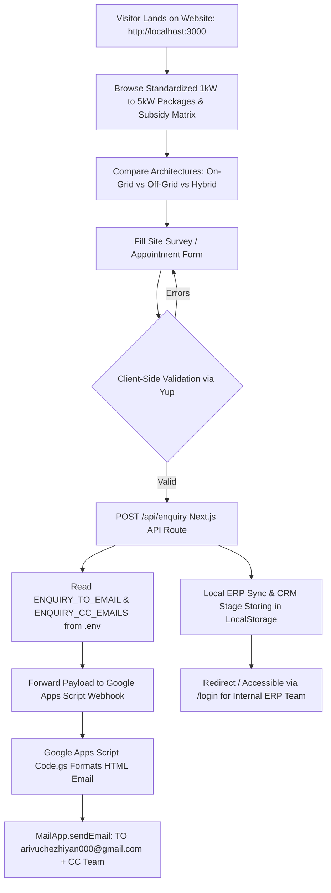

# Odoo Solar — Complete System Architecture & Operational Workflow

An end-to-end technical and operational reference guide detailing the complete lifecycle of both the **Customer-Facing Web Application** (`odoo-solar`) and the **Enterprise Solar ERP Platform** (`backend` + `frontend`).

---

## 1. Technology Stack Overview

```
========================================================================================================
                                     ODOO SOLAR TECHNOLOGY STACK
========================================================================================================

+----------------------------------------------------+-------------------------------------------------+
|  CUSTOMER-FACING WEB APPLICATION (odoo-solar)      |  ENTERPRISE ERP PLATFORM (frontend + backend)   |
+----------------------------------------------------+-------------------------------------------------+
| • Core Framework: Next.js 13.5 (App Router, SSR)   | • Backend Core: Spring Boot 3.4.3 (Java 17)     |
| • Language: TypeScript + React 18                  | • Security: Spring Security 6 + Stateless JWT   |
| • Styling: Vanilla CSS / SCSS + Bootstrap 5        | • Persistence: Spring Data JPA + Hibernate 6    |
| • Icons: Custom Precision Industrial SVG Icons     | • Database: MySQL 8 (36 Normalized Tables)     |
| • Form Validation: React Hook Form + Yup Resolver  | • File Storage: Multipart Local / Upload Mapping|
| • Notifications: React Toastify                    | • Frontend Core: React 19 + TypeScript          |
| • Webhooks: Google Apps Script Web App (Code.gs)   | • Build Tool: Vite 8 (with /api Reverse Proxy)  |
| • Email Engine: Gmail API / MailApp Integration    | • Styling: Tailwind CSS v4 + Solar EPC Tokens   |
| • Configuration: Dynamic .env / .env.local         | • Router & State: React Router v7 + AuthContext |
| • ERP Gateway: Integrated Dashboard at /login      | • Charts & Icons: Recharts + Lucide React       |
| • Local Sync: Browser LocalStorage Fallback CRM    | • Hardware: Barcode Scanning Engine + PDF Certs |
+----------------------------------------------------+-------------------------------------------------+
```

---

## 2. Customer-Facing Web Application Workflow (`odoo-solar`)



### Step 2.1: Discovery & Package Comparison
1. **Homepage (`/`)**: Features the high-efficiency solar banner, company credibility credentials, customer testimonials, and an immediate site appointment booking form.
2. **Standardized Packages (`/service`)**:
   - Customers evaluate **1 kW to 5 kW** turnkey packages.
   - Each package card displays **industrial-grade SVG indicators**:
     - **Panel Specs**: 550W Half-Cut Mono PERC module count.
     - **Rooftop Footprint**: Exact area required (e.g., 80–100 sq.ft for 1kW; 260–300 sq.ft for 3kW).
     - **Daily & Monthly Yield**: Daily generation in kWh and monthly units offset.
     - **Appliance Load Coverage**: Visual indicator showing supported loads (lights, refrigerator, inverter AC, water pump).
     - **Financial & Subsidy Matrix**: Gross Package Price, Central Government PM Surya Ghar Subsidy (up to ₹78,000), and **Net Effective Customer Cost**.
3. **Architecture Guidance (`/service-details`)**:
   - Technical comparison between **On-Grid** (net metering, DISCOM sync, highest ROI), **Off-Grid** (LiFePO4 battery bank, 24/7 power independence), and **Hybrid** systems.

### Step 2.2: Lead Capture & Form Submission
- **Component**: [`ContactFormHomeOne.tsx`](file:///c:/Users/arivu/Downloads/sunpower_solar_erp/sunpower_solar_erp/SolerPanel/src/components/forms/ContactFormHomeOne.tsx) & [`ContactForm.tsx`](file:///c:/Users/arivu/Downloads/sunpower_solar_erp/sunpower_solar_erp/SolerPanel/src/components/forms/ContactForm.tsx)
- **Fields Captured**:
  - `Fullname`: Customer contact name.
  - `email`: Customer email for automatic quotation delivery.
  - `phone`: Mobile number for technician survey coordination.
  - `solarSystem`: Capacity dropdown (`1kW`, `2kW`, `3kW`, `4kW`, `5kW`).
  - `systemType`: Architecture dropdown (`On-Grid`, `Off-Grid`, `Hybrid`).
  - `message`: Available shadow-free roof area (e.g., 150 sq.ft) and technical questions.
- **Validation**: Enforced via **Yup Schema Resolver** preventing empty or invalid inputs.

### Step 2.3: Zero-Maintenance Dynamic Email Dispatch (`.env` Integration)
1. Upon submission, the form triggers an asynchronous POST to **`/api/enquiry`**.
2. **Next.js Backend Route ([`src/app/api/enquiry/route.ts`](file:///c:/Users/arivu/Downloads/sunpower_solar_erp/sunpower_solar_erp/SolerPanel/src/app/api/enquiry/route.ts))**:
   - Loads recipient emails dynamically from the server environment:
     - `ENQUIRY_TO_EMAIL=arivuchezhiyan000@gmail.com`
     - `ENQUIRY_CC_EMAILS=kavinsoorya2470049@ssn.edu.in,ashwathram2470063@ssn.edu.in,naveenkumar2470051@ssn.edu.in`
   - Injects `toEmail` and `ccEmails` into the webhook payload.
   - Forwards the request to the deployed Google Apps Script Web App URL (`APPSCRIPT_WEBAPP_URL`).
3. **Google Apps Script ([`google-apps-script/Code.gs`](file:///c:/Users/arivu/Downloads/sunpower_solar_erp/sunpower_solar_erp/SolerPanel/google-apps-script/Code.gs))**:
   - Executes `doPost(e)` on Google's cloud server.
   - Dynamically reads the `toEmail` and `ccEmails` from the incoming payload.
   - Renders a responsive, high-contrast HTML email table with customer details, solar capacity, system type, rooftop area, and timestamp.
   - Dispatches the email through Google's mail gateway via `MailApp.sendEmail()`.
   - **Key Advantage**: Changing recipients in `.env` immediately redirects future emails without ever touching or re-deploying the Apps Script!

---

## 3. Enterprise ERP System Workflow (`frontend` + `backend`)

The ERP connects five key operational departments: **Sales**, **Engineering/Technicians**, **Warehouse/Logistics**, **Finance**, and **Customer Support**, all supervised by the **Managing Director**.

```
========================================================================================================
                                      END-TO-END ERP PIPELINE
========================================================================================================

  [Website / Lead]
         │
         ▼
  1. ENQUIRY STAGE       ──> EnquiriesPage / EnquiryService.createEnquiry()
         │                    Lead captured, phone validated, assigned to Sales Consultant.
         ▼
  2. SITE SURVEY GATE    ──> SiteSurveysPage / SiteSurveyService.scheduleSurvey()
         │                    Technician dispatched; verifies roof area, tilt, shadow, grid feasibility.
         │                    Survey must reach status "APPROVED" before a quotation can exist!
         ▼
  3. BOM & QUOTATION     ──> QuotationsPage / QuotationService.createQuotation()
         │                    BOM calculated from live inventory cost (package_bom * unit_cost).
         │                    Sales discount gate: Discounts > 10% lock for MD approval.
         ▼
  4. ADVANCE PAYMENT     ──> OrdersPage / OrderService.convertQuotationToOrder()
         │                    Enforces 30% advance deposit; converts Quote to Confirmed Sales Order.
         │                    Inventory hardware reserved; triggers Dispatch & Installation jobs.
         ▼
  5. WAREHOUSE & BARCODE ──> DispatchPage / DispatchService.scanBarcodeForDispatch()
         │                    Serialized tracking for Panels, Inverters, and LiFePO4 Batteries.
         │                    Barcodes must be scanned before dispatch status moves to "DELIVERED".
         ▼
  6. INSTALLATION & SYNC ──> InstallationsPage / InstallationService.completeInstallation()
         │                    Technician executes mounting, wiring, earthing resistance < 5 ohms.
         │                    Captures customer digital signature on-site; auto-generates Warranties.
         ▼
  7. FINANCE & SUBSIDY   ──> FinancePage / FinanceService.calculateJobProfitability()
         │                    GST invoicing, real-time job profitability ledger, PM Surya Ghar DBT tracker.
         ▼
  8. SERVICE & WARRANTY  ──> ServiceTicketsPage / ServiceTicketService.createTicket()
                              Barcode lookup verifies active warranty; customer closure gate enforced.
```

---

### Department 1: Sales Department (Lead Capture to Opportunity)
- **Primary Pages**: `EnquiriesPage.tsx`, `QuotationsPage.tsx`
- **Primary Controllers & Services**: `EnquiryController`, `EnquiryService`, `QuotationController`, `QuotationService`
- **Workflow & Key Functions**:
  1. **Lead Ingestion**: Leads generated from the public website or manually keyed in by sales are saved via `EnquiryService.createEnquiry()`.
  2. **Sales Assignment**: The sales lead assigns the lead to a sales consultant using `EnquiryService.assignToSales(id, userId, assignedBy)`.
  3. **Site Survey Request**: If the customer expresses interest, the sales consultant clicks **"Request Site Survey"**, transitioning the enquiry status from `NEW` to `SURVEY_REQUESTED`.

---

### Department 2: Lead Field Engineer & Technicians (Site Feasibility Gate)
- **Primary Pages**: `SiteSurveysPage.tsx`, `InstallationsPage.tsx`
- **Primary Controllers & Services**: `SiteSurveyController`, `SiteSurveyService`, `TechnicianController`
- **Workflow & Key Functions**:
  1. **Survey Scheduling**: `SiteSurveyService.scheduleSurvey()` assigns a certified field technician and sets the inspection date/time.
  2. **Technical Feasibility Assessment**: The field engineer visits the customer's property and executes `SiteSurveyService.submitInspectionReport()`:
     - Measures shadow-free usable rooftop area (in sq.ft).
     - Records roof orientation (Azimuth) and optimal tilt angle (e.g., 13° South).
     - Inspects transformer capacity and DISCOM sanctioned electrical load.
     - Uploads site photos via `SiteSurveyService.addPhoto()`.
  3. **Strict Business Gate**: `SiteSurveyService.reviewAndApprove()` transitions status to `APPROVED`.
     > **Rule**: The system strictly prevents generating a customer quotation if `SiteSurvey.status != APPROVED`. A quote cannot be fabricated without physical verification.

---

### Department 3: Sales Consultant & Automated BOM Engine (Quotation Builder)
- **Primary Pages**: `QuotationsPage.tsx`
- **Primary Controllers & Services**: `SolarPackageController`, `SolarPackageService`, `QuotationService`
- **Workflow & Key Functions**:
  1. **Automated Bill of Materials (BOM) Analysis**:
     - When the sales consultant selects a system (e.g., *3 kW On-Grid Package*), the system queries the relational `package_bom` table.
     - For each hardware entry, it joins with live inventory item purchase costs:
       $$\text{Package BOM Hardware Cost} = \sum (\text{BOM Item Quantity} \times \text{Current Inventory Unit Purchase Price})$$
     - It calculates the precise profit margin before the sales rep quotes the customer.
  2. **Executive Discount Gate**:
     - `QuotationService.createQuotation()` checks the discount percentage requested.
     - If `discountPercent > 10%`, the quotation is flagged as `PENDING_APPROVAL` and locked from customer dispatch until the **Managing Director** approves it.
     - If discount is $\le 10\%$, it auto-approves to `SENT`.

---

### Department 4: Finance Department (Order Conversion & Profitability Ledger)
- **Primary Pages**: `OrdersPage.tsx`, `FinancePage.tsx`
- **Primary Controllers & Services**: `OrderController`, `OrderService`, `PaymentController`, `FinanceService`
- **Workflow & Key Functions**:
  1. **30% Advance Payment Lock**:
     - A quotation cannot be converted to a confirmed order without proof of customer deposit.
     - `OrderService.convertQuotationToOrder()` validates that advance payment $\ge 30\%$ of total quotation value.
  2. **Automatic Job Provisioning**:
     - Once confirmed, `OrderService.ensureDispatchAndInstallation(order)` automatically instantiates:
       - A **Warehouse Dispatch Ticket** (`Dispatch` entity) in `STAGING` state.
       - A **Field Installation Project** (`Installation` entity) in `ASSIGNED` state.
  3. **Real-Time Job-Wise Profitability Ledger**:
     - `FinanceService.calculateJobProfitability(order)` computes:
       $$\text{Net Profit} = \text{Revenue Received} - (\text{Hardware BOM Cost} + \text{Technician Labor Payout} + \text{Direct Site Expenses})$$
     - Calculates Gross Margin %. If margin falls below the company's 25% target, it is highlighted with a warning badge on the Finance Dashboard.
  4. **Government Subsidy Tracking**:
     - Tracks **PM Surya Ghar Muft Bijli Yojana** portal registration numbers, DISCOM approval dates, and Direct Benefit Transfer (DBT) credit milestones into customer bank accounts.

---

### Department 5: Warehouse & Logistics (Serialized Barcode Dispatch)
- **Primary Pages**: `InventoryPage.tsx`, `DispatchPage.tsx`
- **Primary Controllers & Services**: `InventoryController`, `DispatchController`, `DispatchService`, `SerialNumberService`
- **Workflow & Key Functions**:
  1. **Inventory Reservation**: Confirming an order decrements available stock and marks units as `RESERVED`.
  2. **Serialized Component Governance**:
     - High-value hardware components (Solar PV Modules, Hybrid Inverters, Lithium Batteries) are serialized in `serial_numbers`.
  3. **Physical Barcode Verification Gate**:
     - During package picking, warehouse workers use the integrated barcode scanner.
     - `DispatchService.scanBarcodeForDispatch(dispatchId, barcode, dispatchItemId, scannedBy)` validates that the physical hardware matches the assigned BOM serials.
     - The dispatch status cannot change to `CONFIRMED` or `DISPATCHED` without 100% verified barcode scans.

---

### Department 6: Installation, Commissioning & Warranty Activation
- **Primary Pages**: `InstallationsPage.tsx`, `WarrantyPage.tsx`
- **Primary Controllers & Services**: `InstallationController`, `InstallationService`, `WarrantyService`
- **Workflow & Key Functions**:
  1. **Field Commissioning Checklist**:
     - Technicians execute the 5-point safety checklist:
       - Structure torque & stability test (150 km/h wind certification).
       - DC cable polarity and voltage drop test.
       - Chemical earthing resistance check (< 5.0 Ohms).
       - ACDB/DCDB surge protection device (SPD) isolation check.
       - Solar Inverter grid synchronization & net meter test.
  2. **Digital On-Site Sign-Off**:
     - Technician captures the customer's on-site digital signature (`customerSignature` data URI).
  3. **Automatic Warranty Generation**:
     - Upon `InstallationService.completeInstallation()`, the system automatically calls `WarrantyService.generateWarrantiesForOrder()`.
     - Creates legal warranty certificates:
       - **Solar PV Modules**: 20-Year Linear Performance Warranty.
       - **Solar Inverter & Batteries**: 2-Year Comprehensive Warranty.
       - Warranty start date is locked to the official handover date.

---

### Department 7: Customer Support & Warranty-Aware Breakdown Desk
- **Primary Pages**: `ServiceTicketsPage.tsx`
- **Primary Controllers & Services**: `ServiceTicketController`, `ServiceTicketService`
- **Workflow & Key Functions**:
  1. **Serial-Number-Driven Ticket Logging**:
     - When a customer calls with a fault (e.g., Inverter error code *E04*), the agent inputs the device serial number.
     - `ServiceTicketService.createTicket()` checks the `warranties` table:
       - **Under Warranty**: Replacement parts and service fees are locked to **₹0**.
       - **Out of Warranty**: Generates a billable maintenance invoice.
  2. **Customer Satisfaction Gate**:
     - A service ticket cannot be closed (`CLOSED`) until the customer signs off with a satisfaction rating and confirmation.

---

### Department 8: Managing Director & Executive Oversight
- **Primary Pages**: `DashboardPage.tsx`
- **Primary Controllers & Services**: `DashboardController`, `DashboardService`, `FinanceController`
- **Capabilities**:
  - Executive P&L Dashboard: Real-time company revenue, hardware cost, labor expenditure, and net margin.
  - Review and approve sales discounts > 10%.
  - 1-Click CSV data exports for job profitability, invoices, and expense ledgers.

---

## 4. Key Strategic Suggestions & Pipeline Improvements

1. **Automated DISCOM Application Portal Integration**:
   - Currently, PM Surya Ghar application numbers are manually keyed in.
   - *Suggestion*: Add automated DISCOM API webhooks or PDF parsing to ingest DISCOM inspection approvals directly into `FinanceService`.

2. **Automated Weather / Solar Irradiance Integration in Site Surveys**:
   - Integrate the open-source National Renewable Energy Laboratory (NREL) PVWatts API into `SiteSurveyService`. When a technician inputs coordinates, the system can automatically estimate expected annual kilowatt-hour generation based on local solar irradiance data.

3. **Customer WhatsApp Notification Webhook**:
   - In addition to sending email notifications via Google Apps Script, connect an automated WhatsApp Business API (e.g., Twilio or Wati) webhook inside `EnquiryService` and `InstallationService` to send customers appointment confirmations, technician tracking links, and digital warranty certificates directly on WhatsApp.

4. **Multi-Warehouse Stock Transfer**:
   - For regional scale, introduce a `warehouse_id` on the `InventoryItem` and `Dispatch` entities to enable multi-warehouse transfers and regional inventory staging.
